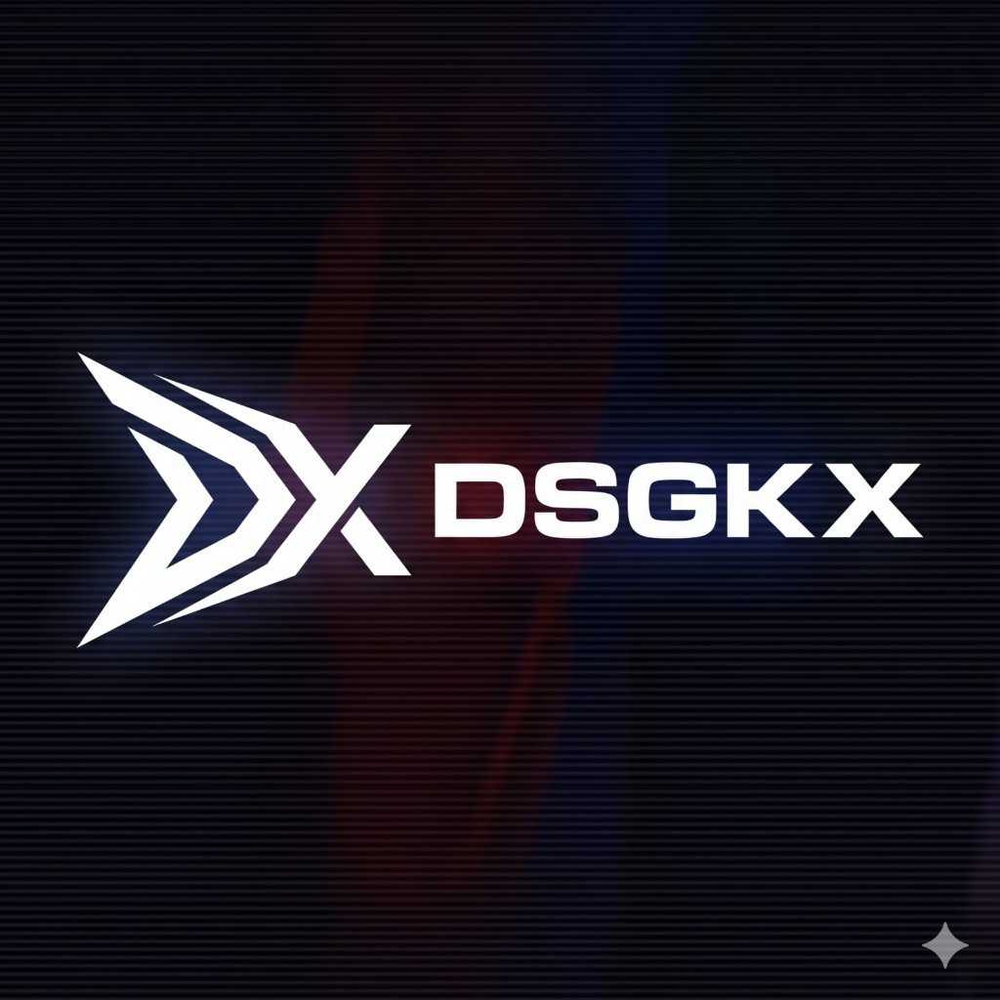

# DSGKX // The Mechanics of Synthetic Cognition

> **An Awwwards-Caliber Swiss Neo-Brutalist Interactive Experience on Large Language Models**  
> Designed and engineered from first principles to demystify Transformers, Attention, Vector Latent Topology, and Probabilistic Sampling.



---

## ✦ Core Design Manifesto

- **Aesthetic**: Swiss Neo-Brutalist — stark monochrome contrast, mathematical telemetry, raw geometric planes, zero generic rounded cards, zero drop shadows.
- **Palette**:
  - `Background`: `#0B0B0C` (Obsidian Carbon)
  - `Primary Ink`: `#F2EFE9` (Bone Alabaster)
  - `Accent`: `#FF3B00` (International Klein / Swiss Safety Orange)
- **Typography**:
  - *Instrument Serif* (Italic editorial elegance at scale)
  - *JetBrains Mono* (Technical telemetry, coordinates, and tensor shapes)

---

## ✦ Features & Architecture

### 1. Interactive 3D Neural Tensor Core
- Built with **Three.js** and WebGL.
- **Geodesic Icosahedron Wireframe** containing an inner rotating octahedron nucleus.
- **280+ High-Dimensional Token Embeddings** ($\mathbb{R}^{4096}$) distributed spherically.
- **120+ Dynamic Attention Rays** ($Q \cdot K^T$) with variable opacity and synaptic shockwave pulsing on click.
- Full 3D orbital mouse drag controls with floating $SO(3)$ matrix telemetry.

### 2. Pinned Horizontal Architectural Timeline
- Pinned scroll timeline powered by **GSAP ScrollTrigger** and **Lenis**.
- 8 detailed stages covering the complete end-to-end forward pass:
  1. **Discretization**: Byte-Pair Encoding (BPE) & UTF-8 byte stream parsing.
  2. **Geometrization**: Continuous High-Dimensional Latent Embeddings ($\mathbb{R}^{4096}$).
  3. **Temporality**: Rotary Position Embeddings (RoPE) and complex harmonic frequencies.
  4. **Synthesis**: Scaled Dot-Product Multi-Head Attention ($\text{Softmax}(QK^T / \sqrt{d_k})V$).
  5. **Highways**: Residual Skip Connections & RMSNorm gradient highways.
  6. **Associative Memory**: SwiGLU Gating & Feed-Forward parameter storage ($4096 \to 14336 \to 4096$).
  7. **Probability**: Softmax Logits, Temperature & Nucleus (Top-P) Sampling.
  8. **Iteration**: Autoregressive Generation Loop & GPU KV-Cache ring buffer.

### 3. Interactive Games & Simulators
- **The Next-Token Roulette / Predictor Arena**: Play against the neural network's probability distribution. Guess model predictions, measure Shannon Surprisal ($-\log_2 P$), adjust Temperature ($T \in [0.1, 2.0]$) and Top-K, and sequentially generate tokens.
- **BPE Subword Slicer & Merge Battle**: Live real-time tokenizer decomposing arbitrary text into subwords, byte-to-token compression ratio, and an interactive merge battle based on Sennrich et al. (2015).
- **Attention Matrix Tactile Mixer & Coreference Solver**: Interactive Query-Key heatmap matrix, token attention rays, multi-head selector, causal mask toggle, and the Winograd schema coreference puzzle (*"it"* attends to *"trophy"*).
- **3D Latent Vector Space Explorer & Arithmetic**: 2D PCA topological plane with word vectors. Execute $\vec{\text{King}} - \vec{\text{Man}} + \vec{\text{Woman}} \approx \vec{\text{Queen}}$ with dynamic cosine similarity calculations and semantic analogy challenges.
- **The Temperature & Hallucination Thermostat**: Move the temperature dial from $0.05$ (frozen argmax) to $0.70$ (equilibrium) to $2.50$ (hallucinatory chaos) and observe real-time Shannon Entropy $H(X) = -\sum P(x) \log_2 P(x)$ in bits.

### 4. Creative Technologist Polish
- **0–100% Split Curtain Preloader**: Technical memory boot sequence with DSGKX emblem and laser scanline.
- **Custom Magnetic Reticle Cursor**: Physics-lerped target with context-aware HUD labels.
- **Procedural Web Audio SFX**: Pure Web Audio oscillator clicks and telemetry tones (toggleable in Navbar).

---

## ✦ Tech Stack

- **Framework**: [Next.js 14](https://nextjs.org/) (App Router, Static Optimization)
- **Styling**: [Tailwind CSS](https://tailwindcss.com/)
- **Smooth Scroll**: [Lenis](https://lenis.darkroom.engineering/)
- **Animation**: [GSAP](https://gsap.com/) & [ScrollTrigger](https://gsap.com/scrolltrigger/)
- **3D Graphics**: [Three.js](https://threejs.org/)
- **Language**: TypeScript

---

## ✦ Getting Started

### Prerequisites
- Node.js 18+ (tested on Node v24)
- npm

### Installation
```bash
git clone https://github.com/darshilgunjal/llm-mechanics.git
cd llm-mechanics
npm install --legacy-peer-deps
```

### Development Server
```bash
npm run dev
```
Open [http://localhost:3000](http://localhost:3000) to view the application.

### Production Build
```bash
npm run build
npm run start
```

---

## ✦ Literature & Citations

- **Vaswani et al. (2017)** — *Attention Is All You Need* (NeurIPS)
- **Sennrich et al. (2015)** — *Neural Machine Translation of Rare Words with Subword Units (BPE)* (ACL)
- **Radford et al. (2019)** — *Language Models are Unsupervised Multitask Learners* (OpenAI GPT-2)
- **Su et al. (2021)** — *RoFormer: Enhanced Transformer with Rotary Position Embedding*

---

## ✦ License
© 2026 DSGKX. All rights reserved.
